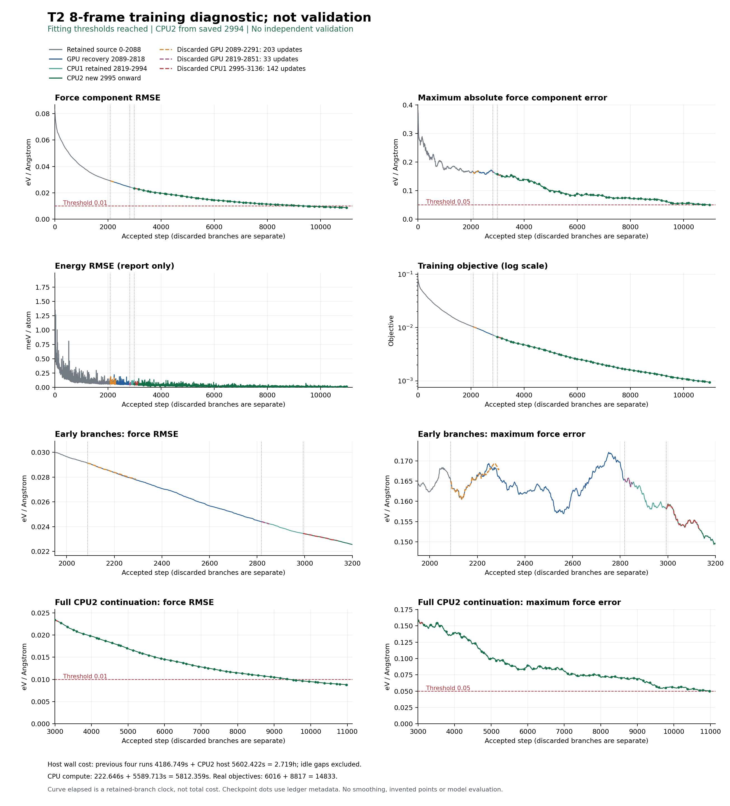

# T2 eight-frame training-fit diagnostic

The diagnostic reached its predefined fitting thresholds on the same eight T2
training frames. At retained accepted update **10,978**, force-component RMSE was
**0.0088132724 eV/Å** and maximum absolute force-component error was
**0.0499480006 eV/Å**, satisfying the respective limits of 0.01 and 0.05 eV/Å.
The run stopped at the first accepted state meeting both limits. Energy RMSE was
**0.0179321 meV/atom**; energy was reported, not used as a pass criterion.

These are **training-fit results, not independent validation**. All 8 frames
contain 91 atoms (2,184 force components in total). They are fixed frames
T2-S004, S008, S012, S016, S020, S024, S028 and S032 from the same trajectory.
They were repeatedly used for optimization and scoring, without a held-out split.
The result does not establish transferability, MD stability, adsorption accuracy,
large-system reliability, or a representational accuracy floor. Independent
validation, manuscript eligibility and deployment qualification remain false.

## Method and provenance

The inherited DeepMD model used FP64 and fixed descriptor statistics and energy
bias. Full eight-frame LBFGS objectives used microbatches of two frames with the
unchanged energy and force coefficients recorded in `run-parameters.json`.
LBFGS started with fresh history at the beginning of the T2 diagnostic; subsequent
recoveries retained saved optimizer history. The final segment ran on eight CPU
threads with a 12 GiB memory limit. Earlier retained segments include GPU work.
The entire curve must therefore not be described as a single CPU-only run.

The retained curve contains 10,979 unsmoothed records, including step 0.
Three interrupted branches (203, 33 and 142 accepted updates) are retained as
separate CSVs; they are not stitched into the canonical curve. The complete
objective count is 14,215 on the retained lineage and **14,833 actually spent**
across all attempts. Native LBFGS closure counts also include cache hits and are
not a substitute for physical evaluation counts.

Summed host-timed cost across five T2 runs was **9,789.171 s (2.719 h)**, excluding
inter-run idle gaps and training of the inherited model. The two CPU segments
used **5,812.359 s** of their shared 7,200 s effective-compute allowance. These
wall-clock quantities include the scopes documented in `summary.json`; the
curve's `elapsed_seconds` column is not the total cost.

The original run recorded successful terminal export and a complete checkpoint
at update 10,978. Their identities are retained in `summary.json`; weights and
the approximately 101 MB checkpoint are intentionally not included. No model
was loaded or rescored to assemble this bundle.

The proposed comparison and joint fitting on all 40 development frames is
**PLANNED, NOT EXECUTED**. No H/R4 sealed labels, 182-atom labels, trajectories,
training-label arrays, operational logs, machine-local paths or manuscript PDFs
are included. See [REPRODUCE.md](REPRODUCE.md) for the limits of reproduction.
